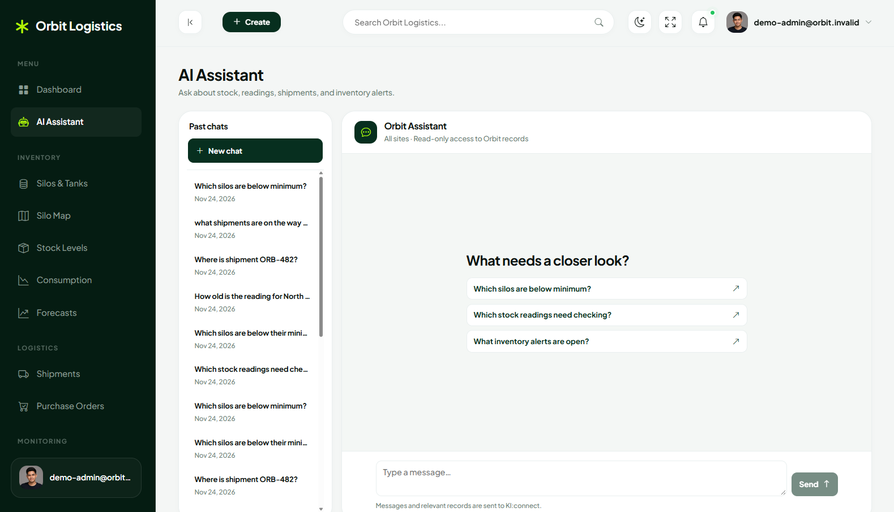
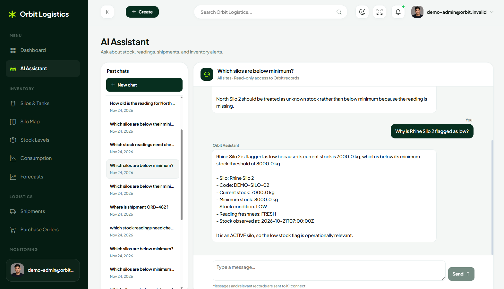
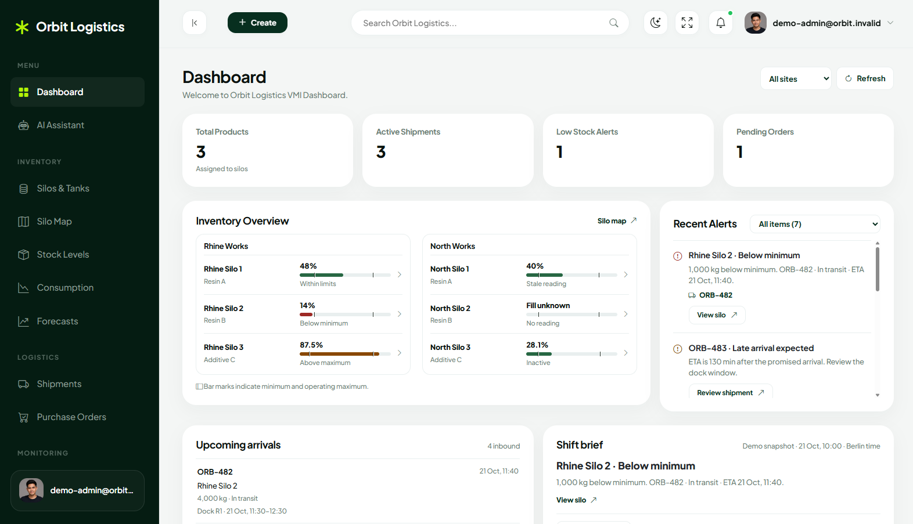
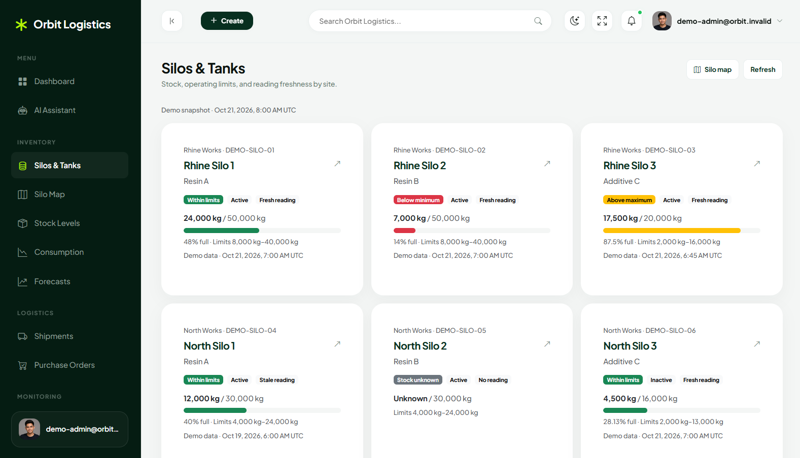
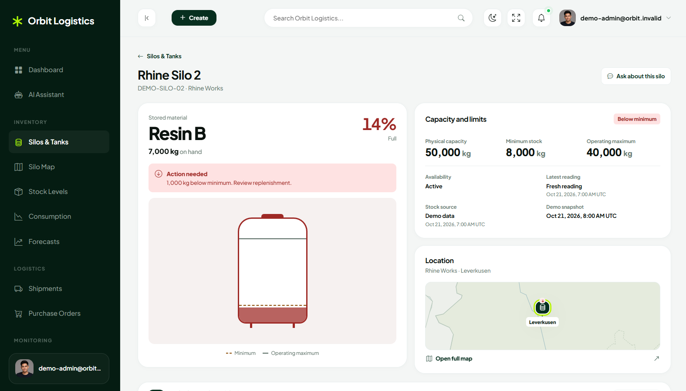
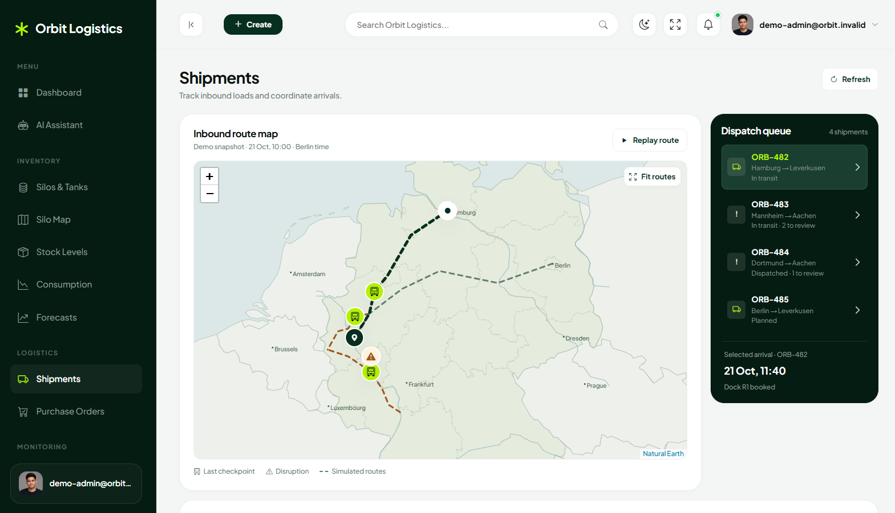

# Spring AI VMI Platform

An AI-powered **Vendor-Managed Inventory (VMI)** platform that lets users query inventory, silo, and shipment data in natural language. Built with **Java, Spring Boot, Spring AI, the Model Context Protocol (MCP), React, and TypeScript**.


---

## Table of Contents

- [Overview](#overview)
- [Key Features](#key-features)
- [System Architecture](#system-architecture)
- [Technology Stack](#technology-stack)
- [Screenshots](#screenshots)
- [Project Structure](#project-structure)
- [Security](#security)
- [Project Goals](#project-goals)
- [License](#license)

---

## Overview

In Vendor-Managed Inventory, suppliers monitor their customers' stock levels and plan replenishment based on actual demand. Doing this usually means switching between dashboards, filters, and reports.

This project replaces that workflow with a conversational interface. An AI assistant, integrated through **Spring AI** and **MCP**, answers questions such as *"Which silos are running low?"* or *"Which shipments are delayed?"* by calling structured backend tools rather than accessing the database directly.

The result is a full-stack application that combines a classic VMI web interface (dashboard, silo management, shipment tracking) with an AI assistant on top of the same business logic.

---

## Key Features

### AI Conversational Assistant
- Natural-language access to inventory, silo, and shipment data
- Tool calling via Spring AI and MCP
- Context-aware, multi-turn conversations
- Answers grounded in live system data

### Model Context Protocol (MCP) Integration
- MCP server exposing backend capabilities as structured, well-defined tools
- Clear separation between AI interaction and business logic: the model never touches the database directly
- Tools cover inventory, silos, shipments, and other operational data

### Inventory & Silo Management
- Inventory visibility across locations
- Silo capacity and stock-level monitoring
- Historical measurements and consumption data
- Configurable thresholds with low-stock and high-stock alerts
- Detection of missing or outdated readings
- Geographic visualization of silos (GeoJSON map)

### Shipment Management
- Shipment monitoring, status, and delivery information
- Journey visualization
- Delivery exceptions and disruptions
- Scheduling and estimated arrival times

### Operational Dashboard
- Inventory and shipment summaries
- Key operational indicators
- Incoming shipment overview
- Items requiring attention

### User & Access Management
- JWT-based authentication
- Role-based authorization
- BCrypt password hashing
- User invitation and account activation
- Email notifications (Spring Boot Mail, Thymeleaf templates)

---

## System Architecture

The application separates presentation, business logic, and AI integration into distinct layers.

```text
              TypeScript + React
                      |
                      | REST API
                      |
                Spring Boot
                      |
          +-----------+-----------+
          |           |           |
       Business    Security    Data Access
       Modules      Layer         Layer
          |                       |
          |                   PostgreSQL
          |
      Spring AI
          |
       MCP Layer
          |
     MCP Tools
          |
   Application Capabilities
   (Inventory, Silos, Shipments,
    and Operational Data)
```

**Design principles**

- **Modular backend:** features are organized as independent packages (`inventory`, `procurement`, `alert`, `chat`, `mcp`, and others).
- **Service reuse:** MCP tools call the same business services as the REST API, so rules and permissions stay consistent.
- **Decoupled AI layer:** the language model interacts with the system only through defined tool contracts.

---

## Technology Stack

| Area | Technologies |
|---|---|
| **Backend** | Java, Spring Boot, Spring Data JPA, Hibernate, Spring Security |
| **AI Integration** | Spring AI, Model Context Protocol (MCP) |
| **Authentication** | JWT, BCrypt |
| **Frontend** | TypeScript, React, GeoJSON / map visualization |
| **Database** | PostgreSQL |
| **Notifications** | Spring Boot Mail, Thymeleaf |
| **Build & Deployment** | Maven, npm, Docker, Docker Compose |
| **Tooling** | Postman |

---

## Screenshots

### AI Conversational Assistant



### Dashboard


### Silo Management



### Shipment Management


---

## Project Structure

```text
conversational-vmi/
│
├── frontend/
│   ├── public/
│   └── src/
│       ├── components/
│       ├── hooks/
│       ├── pages/
│       ├── services/
│       └── ...
│
├── spring-backend/
│   ├── src/
│   │   └── main/
│   │       ├── java/
│   │       │   └── com/orbit/
│   │       │       ├── alert/
│   │       │       ├── auth_users/
│   │       │       ├── chat/
│   │       │       ├── config/
│   │       │       ├── dashboard/
│   │       │       ├── email_notification/
│   │       │       ├── inventory/
│   │       │       ├── mcp/
│   │       │       ├── organization/
│   │       │       ├── procurement/
│   │       │       ├── role/
│   │       │       └── security/
│   │       └── resources/
│   ├── Dockerfile
│   └── pom.xml
│
└── docker-compose.yml
```

---

### Prerequisites

- Java (version as defined in `pom.xml`)
- Maven
- Node.js and npm
- Docker and Docker Compose
- An API key for the configured AI model provider

## Security

- Stateless authentication with JWT
- Role-based access control on protected endpoints
- Passwords hashed with BCrypt
- Controlled, permission-aware access to application functionality, including through the AI assistant

---

## Project Goals

- Explore practical applications of the Model Context Protocol in enterprise software
- Build an AI assistant that works with real application capabilities through structured tools
- Apply Spring Boot to build a modular, maintainable backend
- Use TypeScript and React for a type-safe frontend
- Show how conversational interfaces can make operational data easier to access

---

## License

This project is released under the [MIT License](./LICENSE).

---

**Built with Spring Boot, Spring AI, MCP, TypeScript, React, and PostgreSQL.**
